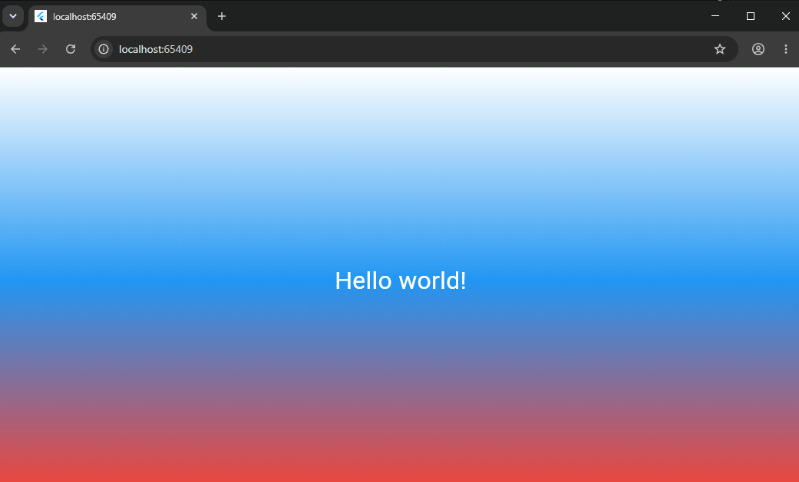

# Flutter Lab3.  Знакомство с Flutter
Мой первый проект на Flutter. Приложение с градиентным фоном и текстом.

## Автор
ФИО: Шаранов Максим Иванович  
Группа: ИСП-242

## Стек и версии
- Flutter 3.47.9
- Dart 3.13.7
- Платформа: Web (Chrome)
- IDE: VS Code

## Скриншот приложения

## Запуск
1. Клонировать репозиторий: `git clone https://github.com/MaxSh67/Flutter_Lab3.git`
2. Перейти в папку проекта: `cd first_flutter_app`
3. Выполнить: `flutter pub get`
4. Запустить командой: `flutter run -d chrome`

## Что изучил
- Разобрался как работает Flutter и что такое виджеты.
- Познакомился с деревом виджетов и `runApp()`.
- Научился использовать `Scaffold`, `Container`, `Center`, `Text`.
- Понял разницу между Hot Reload и Hot Restart.
